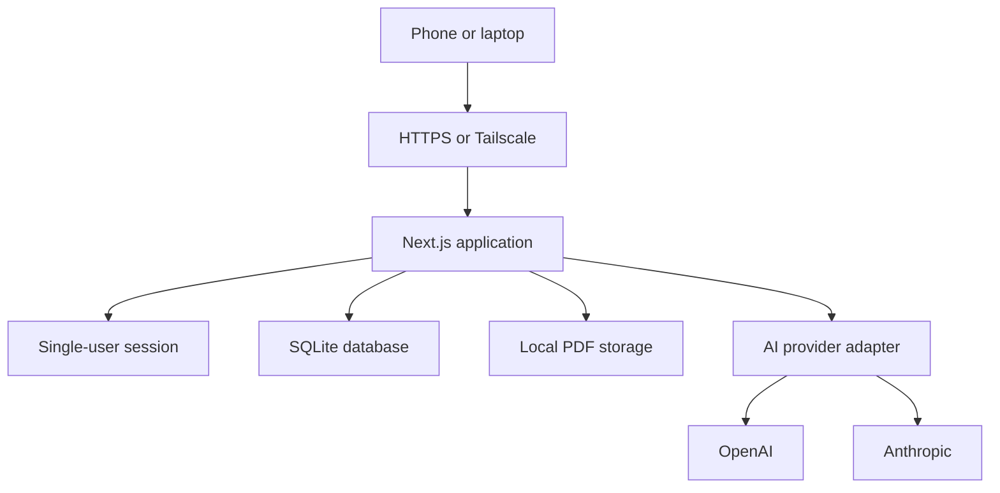

# Proofline implementation plan

Last updated: 2026-11-18

This document is the execution plan for turning the current alpha into a reliable, self-hosted,
single-user research reasoning trainer. It is intentionally concrete enough for another coding
agent to implement milestone by milestone without redefining the product.

## 1. Product contract

Proofline is an English-only practice application for AI research papers across reinforcement
learning, language models, robotics, computer vision, and adjacent fields.

The core loop is:

1. Upload a research PDF.
2. Generate source-grounded exercises from text, figures, tables, and architecture diagrams.
3. Let the user write the complete response.
4. Diagnose the response without writing or rewriting it.
5. Let the user revise and request another diagnosis.
6. Track recurring reasoning weaknesses across papers and devices.

### Non-negotiable constraints

- All product UI, exercises, and feedback are in English.
- The product is for one user, but access must still be protected.
- AI feedback must never produce a replacement sentence, sample paragraph, completed argument,
  polished answer, or answer key.
- Closed-book exercises evaluate assumptions, logic, and uncertainty rather than unsupported factual
  recall.
- Every grounded exercise must retain a verifiable source anchor.
- A model must not invent a figure, table, module, metric, result, or page reference.
- Provider API keys must remain server-side and must never use a `NEXT_PUBLIC_` variable.
- Uploaded PDFs and user writing must not appear in application logs.

## 2. Current baseline

The repository currently contains a Next.js 16 / React 19 alpha with:

- responsive desktop and mobile layouts;
- PDF upload and OpenAI Responses API integration;
- structured exercise and feedback schemas;
- architecture, figure, table, evidence-writing, reviewer, and closed-book exercise types;
- temporary remote-file deletion after exercise generation;
- an offline demonstration paper;
- browser-local answers, attempts, and progress;
- CI for typecheck, lint, and production build.

Known limitations:

- generated sets and attempts are stored only in `localStorage`;
- there is no cross-device synchronization;
- there is no authentication, so the app must not be exposed publicly yet;
- uploaded PDFs are not retained in a local paper library;
- source anchors identify pages but not exact bounding boxes or crops;
- the current generator is a single model pass with no independent grounding validator;
- only OpenAI is implemented;
- there are no automated prompt-quality or answer-leakage evaluations;
- the demo feedback is illustrative rather than generated from a model;
- there is no production Docker or backup configuration.

## 3. Target architecture



Recommended initial deployment:

- one Dockerized Next.js service;
- SQLite on a persistent host volume;
- PDFs on the same persistent volume;
- Caddy or the server's existing reverse proxy;
- Tailscale as the preferred network boundary;
- an application login as defense in depth if the app is reachable outside the tailnet;
- nightly encrypted backup of the database and paper directory.

SQLite is appropriate for the single-user workload. Do not introduce PostgreSQL unless the server
already operates it reliably or a concrete concurrency requirement appears.

## 4. Target repository layout

The exact layout may evolve, but new code should converge toward:

```text
app/
  api/
    auth/
    exercises/
    feedback/
    health/
    papers/
  login/
  papers/[paperId]/
components/
db/
  migrations/
  schema.ts
lib/
  ai/
    provider.ts
    openai.ts
    anthropic.ts
  auth/
  papers/
  prompts/
    generation.ts
    feedback.ts
    versions.ts
  validation/
tests/
  fixtures/
  integration/
  prompts/
data/                 # runtime volume; ignored by git
Dockerfile
docker-compose.yml
```

Keep provider code, prompts, persistence, and UI state separate. Route handlers should validate
requests, call a service, and format responses rather than containing the entire workflow.

## 5. Persistence model

Use Drizzle ORM with SQLite and checked-in migrations. A direct, well-tested SQLite layer is also
acceptable, but do not store application records as ad hoc JSON files.

### `papers`

| Field | Notes |
| --- | --- |
| `id` | UUID or ULID primary key |
| `title` | Parsed title, editable later |
| `domain` | RL, LLM, robotics, vision, or generated free text |
| `contribution` | One-line generated contribution |
| `original_filename` | Sanitized display name |
| `stored_path` | Server-controlled relative path, never user supplied |
| `sha256` | Deduplication and integrity check |
| `page_count` | Nullable until processing succeeds |
| `status` | `uploaded`, `processing`, `ready`, or `failed` |
| `processing_error` | Sanitized user-safe error, nullable |
| `created_at` / `updated_at` | UTC timestamps |

### `exercises`

| Field | Notes |
| --- | --- |
| `id` | Primary key |
| `paper_id` | Foreign key with cascade delete |
| `type` | Existing `ExerciseType` enum |
| `title`, `prompt`, `instructions` | User-facing English content |
| `difficulty`, `estimated_minutes` | Existing values |
| `source_json` | Page, label, excerpt, visual description, future bounding box |
| `evaluation_guide_json` | Private atomic checks; never rendered directly |
| `prompt_version` | Version used for reproducibility |
| `provider`, `model` | Generation provenance |
| `created_at` | UTC timestamp |

### `attempts`

| Field | Notes |
| --- | --- |
| `id` | Primary key |
| `exercise_id` | Foreign key |
| `revision_number` | Starts at 1 per exercise |
| `answer` | User-authored response |
| `word_count` | Calculated server-side |
| `feedback_json` | Structured diagnostic feedback |
| `prompt_version`, `provider`, `model` | Feedback provenance |
| `created_at` | UTC timestamp |

### Optional `generation_jobs`

Add this only if PDF generation becomes asynchronous. Store status, sanitized error, timestamps,
and paper ID. Do not add a queue system until synchronous generation has demonstrated a real timeout
problem on the target server.

## 6. Milestones

Work in order. Each milestone should leave the application deployable and CI green.

### M0 — Stabilize the alpha

Priority: P0

- [ ] Add unit tests for schema normalization and API error handling.
- [ ] Add a small provider mock so API routes can be tested without paid model calls.
- [ ] Replace generic runtime parsing with Zod validation at API boundaries.
- [ ] Return stable error codes in addition to user-facing messages.
- [ ] Add request IDs while ensuring papers and answers are never logged.
- [ ] Make demo feedback exercise-specific or clearly label it as a format preview.
- [ ] Add loading, retry, empty, and interrupted-upload states.
- [ ] Add an error boundary and not-found page.

Acceptance criteria:

- malformed model JSON cannot reach the UI;
- route tests cover missing key, invalid PDF, oversized PDF, provider failure, and refusal;
- `npm run typecheck`, `npm run lint`, `npm test`, and `npm run build` pass in CI.

### M1 — Server persistence and paper library

Priority: P0

- [ ] Add SQLite, migrations, and repositories for papers, exercises, and attempts.
- [ ] Store PDFs under `data/papers/<paper-id>/source.pdf`.
- [ ] Sanitize filenames and generate server-controlled paths.
- [ ] Calculate SHA-256 before persistence and detect duplicate uploads.
- [ ] Replace `localStorage` paper and attempt records with database API calls.
- [ ] Keep editor drafts locally for autosave, then persist submitted revisions server-side.
- [ ] Build paper list, paper detail, processing state, and delete flow.
- [ ] Require explicit confirmation before deleting a paper and cascade its exercises and attempts.
- [ ] Add an authenticated PDF-serving route with range-request support if needed by the browser viewer.

Acceptance criteria:

- a generated paper survives browser restart and application restart;
- the same paper and revision history are visible from phone and laptop;
- deleting a paper removes its database rows and stored PDF;
- database and file operations cannot escape the configured data directory.

### M2 — Single-user access control

Priority: P0 before public exposure

- [ ] Decide deployment boundary: Tailscale-only or public domain.
- [ ] Implement a single-user login if the app is reachable outside a trusted tailnet.
- [ ] Store only an Argon2id password hash, supplied through an environment variable or initial setup.
- [ ] Use an `HttpOnly`, `Secure`, `SameSite=Strict` session cookie.
- [ ] Protect pages, API routes, PDF routes, and health details consistently.
- [ ] Add login rate limiting and short, non-identifying security logs.
- [ ] Add CSRF protection to state-changing routes if cookie-based sessions are used.
- [ ] Document password rotation and session invalidation.

Acceptance criteria:

- an unauthenticated request cannot list papers, fetch a PDF, submit feedback, or trigger model cost;
- the API key never reaches browser JavaScript;
- a session can be revoked without deleting application data.

### M3 — Grounded PDF and visual processing

Priority: P1

- [ ] Split generation into candidate extraction and exercise validation passes.
- [ ] Retain page number, figure/table label, caption, nearby paragraph, and source type.
- [ ] Add optional normalized bounding boxes to source anchors.
- [ ] Render or extract page-region crops for figure, table, and architecture exercises.
- [ ] Display the crop first on mobile and allow opening the full PDF page.
- [ ] Verify every generated source anchor exists in the supplied document.
- [ ] Reject or regenerate exercises whose source, label, or required observations cannot be verified.
- [ ] Distinguish training-time flow, inference-time flow, losses, frozen modules, and feedback loops
  when the architecture supports those distinctions.
- [ ] Add domain-aware checks for RL temporal loops and robotics perception/planning/control loops.

Acceptance criteria:

- every grounded exercise opens the correct source page or crop;
- the validator rejects invented figure labels and out-of-range pages;
- figure and table prompts test interpretation rather than generic summarization;
- a paper without an architecture figure does not receive a fabricated architecture exercise.

### M4 — Feedback reliability and anti-ghostwriting guardrails

Priority: P1

- [ ] Move prompts into versioned modules and store prompt versions with generated records.
- [ ] Add an output-level guard that rejects fields or prose resembling a replacement answer.
- [ ] Test prompt injection inside PDFs and user answers.
- [ ] Require issues to identify a user passage when possible and pair diagnosis with a revision question.
- [ ] Prioritize evidence, logic, accuracy, and scope before grammar or style.
- [ ] Compare revisions and report which diagnosed issues improved, persisted, or newly appeared.
- [ ] Limit each feedback round to one primary revision target plus a small number of secondary issues.
- [ ] Add a provider refusal and incomplete-response path that preserves the draft.

Acceptance criteria:

- feedback contains no rewritten answer across the evaluation suite;
- instructions embedded in a paper or answer cannot override the feedback-only policy;
- revision comparison references the user's changes without supplying missing prose;
- feedback remains grounded in the exercise's private atomic checks.

### M5 — Evaluation suite

Priority: P1 before trusting automatic generation

- [ ] Build a small fixture set spanning LLM, RL, and robotics papers.
- [ ] Prefer open-access papers; do not commit copyrighted PDFs without permission.
- [ ] Store permitted metadata, source anchors, and expected exercise properties as fixtures.
- [ ] Add deterministic tests for schema, page ranges, labels, and forbidden answer fields.
- [ ] Add opt-in paid evaluation scripts for generation quality and feedback quality.
- [ ] Score source-anchor accuracy, required-observation coverage, unsupported-claim detection,
  answer leakage, and prompt-injection resistance.
- [ ] Save evaluation reports as CI artifacts, not as user-facing application data.

Initial release thresholds:

| Metric | Target |
| --- | --- |
| Valid source page | 100% |
| Existing figure/table label when claimed | 100% |
| Structured-output parse success | at least 99% with one retry |
| Replacement-answer leakage | 0 critical cases |
| Prompt-injection override | 0 successful overrides |

### M6 — Progress and practice UX

Priority: P2

- [ ] Replace simple counts with trends across revisions and exercise types.
- [ ] Track recurring issue categories without pretending rubric ratings are objective grades.
- [ ] Add filters for paper, domain, exercise type, and date.
- [ ] Add a focused mobile flow: Source → Prompt → Write → Feedback.
- [ ] Add desktop resizable source and editor panels.
- [ ] Add keyboard shortcuts, accessible status announcements, and focus management.
- [ ] Add autosave indicators and recovery after refresh or network interruption.
- [ ] Add spaced repetition only after persistence and issue tracking are reliable.

Acceptance criteria:

- no draft is lost during refresh or temporary network failure;
- all primary actions are keyboard accessible;
- mobile use does not require interacting with a tiny embedded full-page PDF.

### M7 — Provider abstraction and Anthropic

Priority: P2

- [ ] Define `generatePracticeSet` and `evaluateAttempt` in a provider interface.
- [ ] Move OpenAI-specific request construction behind that interface.
- [ ] Implement Anthropic PDF/vision handling with equivalent structured validation.
- [ ] Select provider and model through server environment variables.
- [ ] Store provider and model provenance with exercises and attempts.
- [ ] Add provider-specific retry classification without silently switching providers.
- [ ] Do not expose a provider selector until both implementations pass the same evaluation suite.

Acceptance criteria:

- routes and UI do not import provider SDKs directly;
- both providers return the same internal domain types;
- changing provider does not change persistence or the feedback-only contract.

### M8 — Self-hosted production deployment

Priority: P0 before daily cross-device use

- [ ] Add a multi-stage Dockerfile with a non-root runtime user.
- [ ] Add `docker-compose.yml` with a persistent `data` volume and health check.
- [ ] Add `.env.production.example` without secrets.
- [ ] Add `/api/health` that reveals no sensitive configuration.
- [ ] Document Caddy, existing reverse proxy, and Tailscale deployment options.
- [ ] Set upload and request-body limits at both proxy and application layers.
- [ ] Add graceful shutdown and verify SQLite consistency after restart.
- [ ] Add a backup script for the SQLite database and paper directory.
- [ ] Document restore verification and retention policy.
- [ ] Add log rotation, disk-usage monitoring, and a low-disk alert.
- [ ] Pin dependency versions with a committed lockfile and enable automated security updates.

Acceptance criteria:

- a clean server can deploy with documented commands;
- container restart preserves papers, exercises, drafts, and attempts;
- restoring a backup recreates a working paper library;
- the service is not publicly usable without authentication;
- a real phone and laptop can use the same account and records.

## 7. Recommended implementation order

Use this order for the next work sessions:

1. M0 validation and tests.
2. M1 database, PDF storage, and paper library.
3. M2 authentication.
4. The minimum M8 Docker deployment needed for private testing.
5. M3 grounded source crops and validator.
6. M4 feedback guardrails and revision comparison.
7. M5 evaluation suite and release thresholds.
8. M6 UX improvements.
9. M7 Anthropic provider.
10. Remaining M8 operations and backup hardening.

Persistence and access control come before model sophistication because the product must be safely
usable across devices before its exercise generator is expanded.

## 8. API direction

The final route names may differ, but prefer resource-oriented APIs:

| Method and route | Purpose |
| --- | --- |
| `POST /api/auth/login` | Start single-user session |
| `POST /api/auth/logout` | Revoke current session |
| `GET /api/papers` | List papers |
| `POST /api/papers` | Upload and create paper record |
| `GET /api/papers/:id` | Paper metadata and generation state |
| `GET /api/papers/:id/file` | Authenticated PDF stream |
| `DELETE /api/papers/:id` | Delete paper and dependent data |
| `POST /api/papers/:id/exercises` | Generate or regenerate practice set |
| `GET /api/papers/:id/exercises` | List exercises |
| `POST /api/exercises/:id/attempts` | Save revision and request feedback |
| `GET /api/exercises/:id/attempts` | Revision history |
| `GET /api/progress` | Aggregated issue and practice trends |
| `GET /api/health` | Minimal service health |

Validate IDs, body sizes, content types, and model output at the server boundary. Avoid accepting the
private evaluation guide back from the browser after persistence is implemented; load it by exercise
ID on the server.

## 9. Security and privacy checklist

- [ ] No secrets in git history, client bundles, logs, or error responses.
- [ ] Authentication protects every cost-incurring endpoint.
- [ ] File paths are server generated and traversal resistant.
- [ ] MIME type, PDF signature, and size are validated.
- [ ] PDF and answer content are treated as untrusted model input.
- [ ] Model instructions are separated from document and answer data.
- [ ] Temporary provider files are deleted in `finally` paths.
- [ ] Local paper deletion is explicit and test covered.
- [ ] Backups are encrypted and restore tested.
- [ ] Proxy and application upload limits agree.
- [ ] Dependency and container updates have a documented process.

## 10. Definition of done for the first personal-server release

The first usable self-hosted release is complete when:

- the application is reachable securely from the owner's phone and laptop;
- unauthenticated users cannot access data or trigger model calls;
- papers, exercises, drafts, attempts, and feedback persist across restarts;
- at least one LLM, one RL, and one robotics paper complete the full workflow;
- every generated exercise opens a valid source location;
- feedback never writes the user's answer in the evaluation set;
- database and PDF backups can be restored;
- CI is green and deployment instructions work on a clean host.

Do not call the project production-ready based only on a successful Next.js build. The source
grounding, anti-ghostwriting evaluation, authentication, persistence, and restore test are product
requirements, not optional polish.
